# Prototype gallery

**Current direction.** The working grammar is the hybrid tone-field: three tiers per cell, with every tier boundary inside a transition piece, and the boundaries drawn as marching tiles (ink mode shows them as black strokes). The working grid is 27x38 (1026 pieces), adopted in `docs/DECISIONS.md`. The subject set "Field, Wood and Water" (`experiments/011-subjects`) is a hare at dawn, an owl at dusk and a swan at midnight, drawn in value inversion. Uniqueness comes from the artwork, not from connector algebra (`docs/DECISIONS.md`, last entries). The current best full render is 011 `27x38-v2/run-full` and the current best ink render is 011 `27x38-v2/run-ink`; their blind tests are pending.

Visual index of the `experiments/` runs that produced a `triptych.png`. Figures come from each run's `summary.md` and the experiment README. Distinctiveness and grid scores come from the latest `blind-test-*.md` in the folder. A dash means not recorded. Folders 001, 003 and 007 have no triptych and are not listed. 003 also has no README.

## At a glance

| Experiment | Run | Size (cols x rows) | Rotation | Shared AB / AC / BC | Piece gates | Scene gates | Distinctiveness | Grid score (A / B / C) |
|---|---|---|---|---|---|---|---|---|
| 002 | run-none | 8x10 | none | 13 / 11 / 15 | FAIL\* | FAIL\* | - | - |
| 002 | run-none-v2 | 8x10 | none | 10 / 13 / 14 | FAIL | FAIL | - | - |
| 002 | run-quarter | 8x10 | quarter | 4 / 5 / 4 | PASS | FAIL | 2/5 | 3 / 4 / 3 |
| 004 | run-none | 20x25 | none | 0 / 1 / 0 | PASS | FAIL | - | - |
| 004 | run-quarter | 20x25 | quarter | 0 / 0 / 0 | PASS | FAIL | 4/5 | 5 / 5 / 5 |
| 005 | run-quarter (carry-forward) | 20x25 | quarter | 0 / 0 / 0 | PASS | FAIL | 4/5 | 4 / 4 / 3 |
| 005 | run-quarter-v2 | 20x25 | quarter | 0 / 0 / 0 | PASS | FAIL | - | - |
| 005 | run-quarter-v3 | 20x25 | quarter | 0 / 0 / 0 | PASS | FAIL | - | - |
| 005 | run-ink-v3 (black contour, pre-fix) | 20x25 | quarter | 0 / 0 / 0 | PASS | FAIL | - | - |
| 005 | run-quarter-v3b | 20x25 | quarter | 0 / 0 / 0 | PASS | FAIL | - | - |
| 005 | run-ink-v3b (black contour) | 20x25 | quarter | 0 / 0 / 0 | PASS | FAIL | - | - |
| 005 | run-full-v5 | 20x25 | quarter | 0 / 0 / 0 | PASS | FAIL | 4/5 | 3 / 3 / 3 |
| 005 | run-ink-v5 (black contour) | 20x25 | quarter | 0 / 0 / 0 | PASS | FAIL | 4/5 | - |
| 005 | run-full-v5eq (budget-equalized) | 20x25 | quarter | 0 / 0 / 0 | PASS | FAIL | - | - |
| 005 | run-ink-v5eq (budget-equalized, black contour) | 20x25 | quarter | 0 / 0 / 0 | PASS | FAIL | - | - |
| 005 | run-full-v5eq2 (equalizer v2) | 20x25 | quarter | 0 / 0 / 0 | PASS | FAIL | 4/5 | 4 / 4 / 3 |
| 005 | run-ink-v5eq2 (equalizer v2, black contour) | 20x25 | quarter | 0 / 0 / 0 | PASS | FAIL | - | - |
| 005 | run-full-v6 (diagonal tiles) | 20x25 | quarter | 0 / 0 / 0 | PASS | FAIL | - | - |
| 005 | run-ink-v6 (diagonal tiles, black contour) | 20x25 | quarter | 0 / 0 / 0 | PASS | FAIL | - | - |
| 006 | run-none | 8x10 | none | 7 / 2 / 4 | PASS | PASS | - | - |
| 006 | run-quarter | 8x10 | quarter | 1 / 0 / 0 | PASS | PASS | - | - |
| 008 | run-quarter | 20x24 / 30x16 / 40x12 | quarter | 0 / 0 / 0 | PASS (invalid) | FAIL | not evaluated; runs invalid | not evaluated; runs invalid |
| 008 | run-flat | 20x24 / 30x16 / 40x12 | none | 0 / 0 / 0 | PASS (invalid) | FAIL | not evaluated; runs invalid | not evaluated; runs invalid |
| 008 | run-quarter-v2 (round 2, valid) | 20x24 / 30x16 / 40x12 | quarter | 0 / 0 / 0 | PASS | FAIL | not evaluated | not evaluated |
| 008 | run-flat-v2 (round 2, valid) | 20x24 / 30x16 / 40x12 | none | 2 / 0 / 0 | PASS | FAIL | not evaluated | not evaluated |
| 011 | prev-attempt/run-quarter (hare, owl, whale) | 20x25 | quarter | 0 / 0 / 0 | PASS | FAIL | - | - |
| 011 | 27x38/run-full (v1) | 27x38 | quarter | 0 / 0 / 0 | PASS | FAIL | 4/5 | 3 / 3 / 3 |
| 011 | 27x38/run-ink (v1) | 27x38 | quarter | 0 / 0 / 0 | PASS | FAIL | 5/5 | - |
| 011 | 27x38/run-full-v2 (S-L transitions) | 27x38 | quarter | 0 / 0 / 0 | PASS | FAIL | - | - |
| 011 | 27x38/run-ink-v2 (S-L transitions) | 27x38 | quarter | 0 / 0 / 0 | PASS | FAIL | - | - |
| 011 | 27x38/run-full-v3 (surplus placement) | 27x38 | quarter | 0 / 0 / 0 | PASS | FAIL | - | - |
| 011 | 27x38/run-ink-v3 (surplus placement) | 27x38 | quarter | 0 / 0 / 0 | PASS | FAIL | - | - |
| 011 | **27x38-v2/run-full** (current best full render) | 27x38 | quarter | 0 / 0 / 1 | PASS | FAIL | - | - |
| 011 | **27x38-v2/run-ink** (current best ink render) | 27x38 | quarter | 0 / 0 / 1 | PASS | FAIL | - | - |
| 013 | g20x25 run-full / run-ink | 20x25 | quarter | 0 / 0 / 0 | PASS | FAIL | - | - |
| 013 | g25x30 run-full / run-ink | 25x30 | quarter | 0 / 0 / 0 | PASS | FAIL | - | - |
| 013 | g27x38 run-full / run-ink | 27x38 | quarter | 0 / 0 / 0 | PASS | FAIL | - | - |
| 013 | g32x48 run-full / run-ink | 32x48 | quarter | 0 / 0 / 0 | PASS | FAIL | - | - |

- Shared counts are piece-level adjacencies: pieces touching in both solutions of the pair.
- Blind tests cover these runs: 002 `blind-test-2`, 004 `blind-test-1`, 005 `blind-test-1` (run-quarter), 005 `blind-test-2` (run-full-v5), 005 `blind-test-3` (run-full-v5eq2) and 005 `blind-test-ink-1` (run-ink-v5), and 011 `blind-test-full-1` and `blind-test-ink-1` (27x38/run-full and run-ink). All other runs, including the 005 v3b, v5eq, v6 and run-ink-v5eq2 renders, the 011 v2 and v3 renders, 27x38-v2 and every other 013 render, have no evaluation of their own.
- 008 round 1 runs are invalid (see its section), so their piece and scene gates are indicative only. Round 2 runs are valid.
- \* 002 run-none's `summary.md` has no Gates section. Its gate values come from the round 2 table in `experiments/002-direction-a/README.md`.

## 002: Direction A, first end-to-end render

**Goal:** first end-to-end render of design direction A ("Dapple Mosaic") with three 8x10 scenes: The Lone Tree (A), Isle and Sail (B), Snow Peak (C).

**Latest blind test** (`blind-test-2.md`, run-quarter): distinctiveness 2/5, grid A 3, B 4, C 3. The tree is named at 2/5 and B and C are unnamed. The earlier test on run-none scored distinctiveness 3/5 and grid 1 / 4 / 3. The README retires this scene set.

**Scene gates, all 002 runs:** FAIL. Same-position overlap 66-71%, 2x2 window reuse 44-57%, transferable blob 27.5-30%. Limits are 25%, 30% and 10%.

### run-none (v1)

- Piece shared: AB 13 (9.15%), AC 11 (7.75%), BC 15 (10.56%). Largest cluster 6.
- Piece gates: FAIL\*. Scene gates: FAIL\*.

### run-none-v2

- Piece shared: AB 10 (7.04%), AC 13 (9.15%), BC 14 (9.86%). Largest cluster 6 (AC and BC).
- Piece gates: FAIL (AB, AC and BC each above the 5% limit; AC and BC clusters of 6 against a limit of 4). Scene gates: FAIL.

### run-quarter

- Piece shared: AB 4 (2.82%), AC 5 (3.52%), BC 4 (2.82%). Largest cluster 3.
- Piece gates: PASS. Scene gates: FAIL.

## 004: Density-field mosaic

**Goal:** each piece is a mixture of stipple dapples, and six tone classes (T0 dark to T5 light) render three 20x25 tone maps (cat, sailboat, tree) that share one exact class histogram.

**Latest blind test** (`blind-test-1.md`, run-quarter): distinctiveness 4/5, grid 5/5 on A, B and C. The tree is recognised (canopy and trunk 4/5). The cat is not recognised and the sailboat is only partly read.

### run-none

- Piece shared: AB 0, AC 1 (0.10%), BC 0.
- Piece gates: PASS. Scene gates: FAIL. A-B 2x2 reuse 44.1% (limit 30%), A-C same-position 25.0% (limit 25%), A-C 2x2 reuse 57.2% (limit 30%), B-C 2x2 reuse 79.6% (limit 30%).

### run-quarter

- Piece shared: AB 0, AC 0, BC 0.
- Piece gates: PASS. Scene gates: FAIL, with the same failures as run-none.

## 005: Hybrid tone-field

**Goal:** three-tier tone maps (dark / mid / light) of a cat, a sailboat and a tree at 20x25, with one piece histogram shared by all three and every tier boundary inside a transition piece.

**Carry-forward grammar:** this run is the current carry-forward grammar; `docs/DECISIONS.md` (last two entries) keeps the hybrid tone-field and treats its scene-level gates as difficulty indicators, not hard gates.

**Latest blind test** (`blind-test-1.md`, run-quarter): distinctiveness 4/5, grid A 4, B 4, C 3. The tree is recognised (canopy and trunk 4/5). The cat and sailboat are not named. **Grid visibility** (`grid-visibility-1.md`): C 2/5, A 3/5; B not scored.

### run-quarter

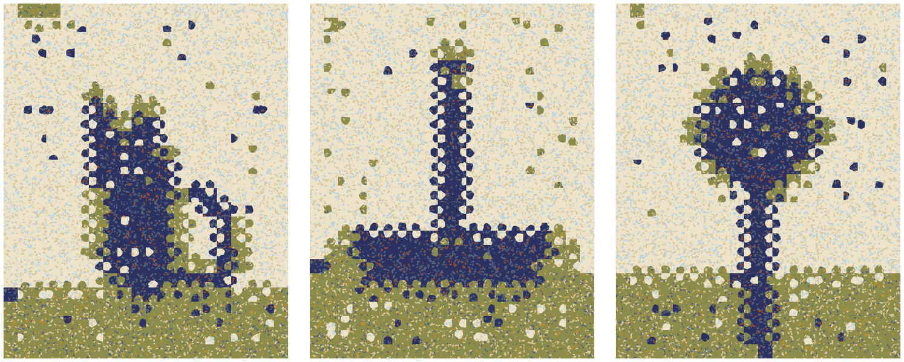

- Piece shared: AB 0 (0.00%), AC 0, BC 0. No clusters.
- Piece gates: PASS. Scene gates: FAIL. Same-position excluding the dominant light class 34.1 / 30.7 / 33.0% (limit 25%), 2x2 reuse 71.1 / 75.2 / 73.0% (limit 30%), transferable blob 31.2 / 31.0 / 25.6% (limit 10%) for A-B / A-C / B-C.

### run-quarter-v2

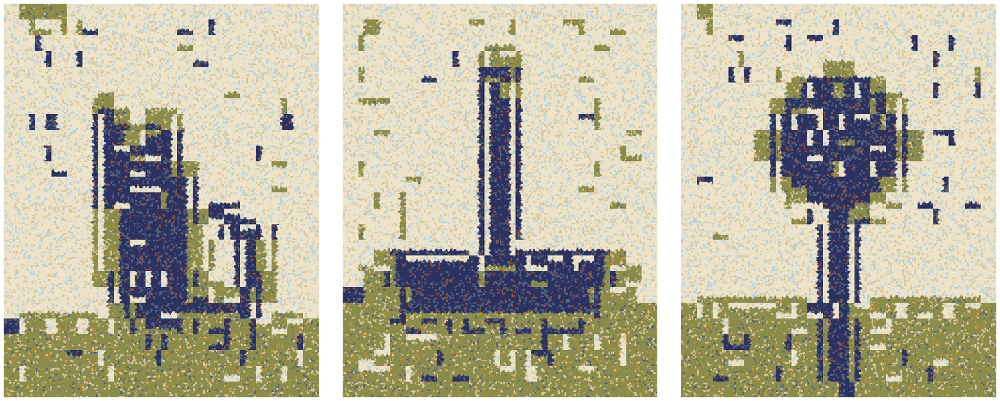

- Changed: rougher, edge-spanning transition masks (README Step 3).
- Piece shared: AB 0 (0.00%), AC 0, BC 0. Piece gates: PASS. Scene gates: FAIL, 2x2 window reuse 71.1 / 75.2 / 73.0% (limit 30%).

### run-quarter-v3

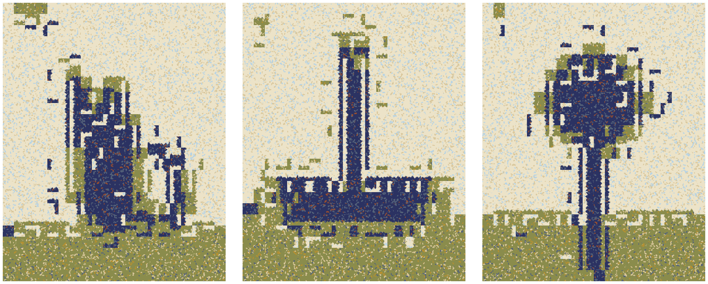

- Changed: minimal, localized surplus (README Step 4); histogram identical across maps, scene gates still fail.
- Piece shared: AB 0 (0.00%), AC 0, BC 0. Piece gates: PASS. Scene gates: FAIL, 2x2 window reuse 67.3 / 75.7 / 76.1% (limit 30%).

### run-ink-v3

- Changed: black-line render of the run-quarter-v3 scenes, before the orientation fix (`docs/FINDINGS.md` entry 15); re-solved as run-ink-v3b. Piece shared: AB 0 (0.00%), AC 0, BC 0. Piece gates: PASS. Scene gates: FAIL, identical to run-quarter-v3b. No evaluation of this run.

### run-quarter-v3b

- Changed: same Step 4 scenes and `classes.json` as v3, re-solved after the orientation fix (`docs/FINDINGS.md` entry 15); rotated pieces per map drop from 390-397 to 335-347, scene metrics unchanged. Piece shared: AB 0 (0.00%), AC 0, BC 0. Piece gates: PASS. Scene gates: FAIL, same-position excl. L 48.4 / 40.8 / 42.5% (limit 25%), weighted overlap 33.5 / 24.9 / 25.5% (limit 25%), 2x2 reuse 67.3 / 75.7 / 76.1% (limit 30%), transferable blob 37.0 / 35.8 / 35.0% (limit 10%). No evaluation of this run.

### run-ink-v3b

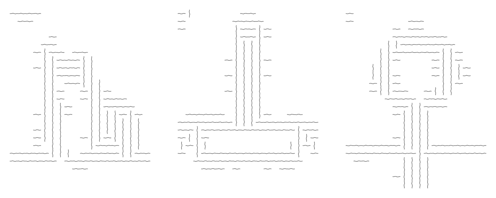

- Changed: black-line contour render (`classes-ink.json`) of the run-quarter-v3b scenes, so the same orientation fix applies. Piece shared: AB 0 (0.00%), AC 0, BC 0. Piece gates: PASS. Scene gates: FAIL, identical to run-quarter-v3b (same-position excl. L 48.4 / 40.8 / 42.5%, 2x2 reuse 67.3 / 75.7 / 76.1%, transferable blob 37.0 / 35.8 / 35.0%). No evaluation of this run.

### run-full-v5

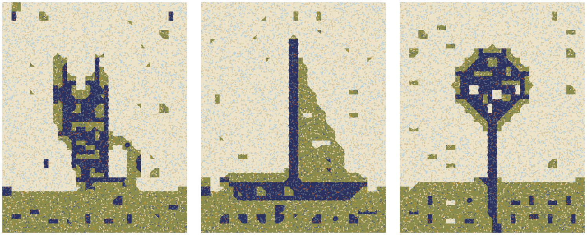

- Changed (Steps 6 and 6b): `scenes-v5.txt` with merged `PQs`/`PQc`/`PQp` classes, boundary budgets and the host and rotation fix, drawn with `classes-v4.json`; transition cells fall from 156-178 to 83-94 per map. Piece shared: AB 0 (0.00%), AC 0, BC 0. Piece gates: PASS. Scene gates: FAIL, same-position excl. L 40.3 / 39.6 / 36.9% (limit 25%), 2x2 reuse 65.8 / 74.3 / 68.6% (limit 30%), transferable blob 46.6 / 46.0 / 46.8% (limit 10%).
- Evaluation (`blind-test-2`): distinctiveness 4/5, grid 3 / 3 / 3. Tree 5/5 (canopy and trunk 5/5), sailboat partly (vessel 3/5, mast 4/5), cat not named. Grid visibility 2: C 4/5, B 4/5, A not recorded.

### run-ink-v5

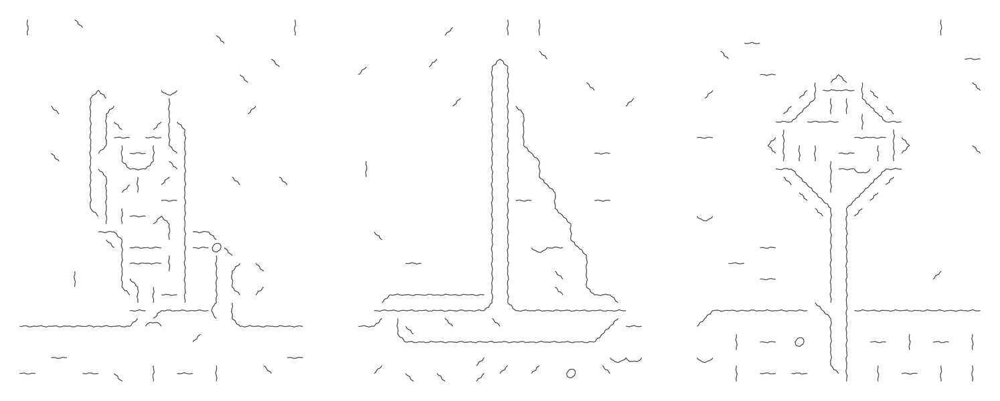

- Changed (Steps 6 and 6b): black-line contour render (`classes-ink.json`) of the run-full-v5 scenes. Piece shared: AB 0 (0.00%), AC 0, BC 0. Piece gates: PASS. Scene gates: FAIL, identical to run-full-v5.
- Evaluation (`blind-test-ink-1`): distinctiveness 4/5, no grid score. Sailboat 3/5 (mast 4/5, hull 3/5), tree 4/5, cat not named. Contour about 70 / 90 / 60% continuous for A / B / C.

### run-full-v5eq

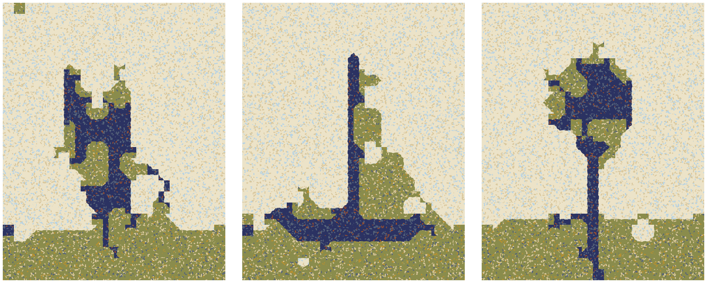
- Changed (Step 7): `equalize_budgets_v5.py` flips up to 24 boundary cells per image, so the surplus falls from 41 / 33 / 44 to 0 / 1 / 0. Olive bites now show in the dark figures, because flips were D-M and M-L only (`docs/FINDINGS.md` entry 20). Piece shared: AB 0 (0.00%), AC 0, BC 0. Piece gates: PASS. Scene gates: FAIL, same-position excl. L 44.5 / 50.9 / 45.6%, 2x2 reuse 70.8 / 78.3 / 75.7%, transferable blob 51.0 / 51.4 / 52.2%. No evaluation of this run.

### run-ink-v5eq

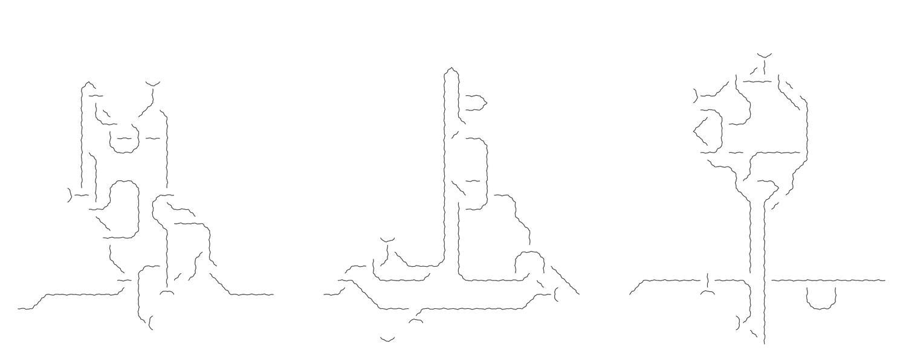
- Changed (Step 7): black-line render of the run-full-v5eq scenes (`classes-ink.json`), with fewer stray fragments; the tree crown is rougher and the sail edge breaks on the right. Piece shared: AB 0 (0.00%), AC 0, BC 0. Piece gates: PASS. Scene gates: FAIL, identical to run-full-v5eq. No evaluation of this run.

### run-full-v6

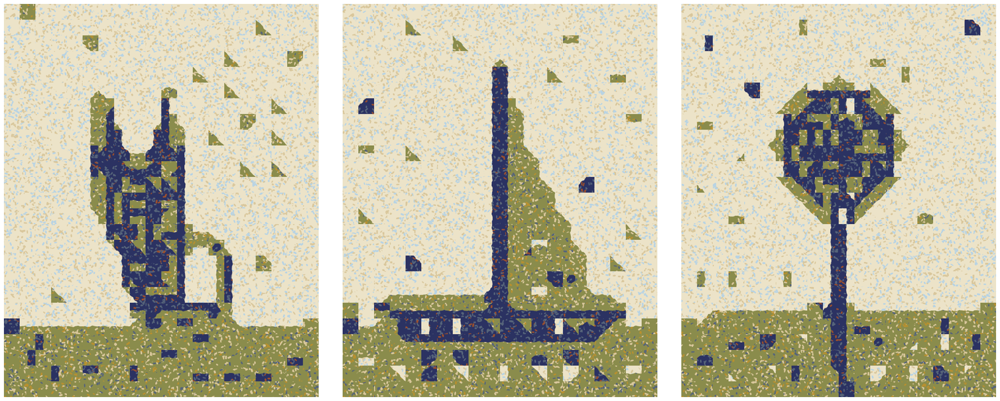
- Changed (Step 8): a 2-2 tie goes to the lighter tier, 14 diagonal tiles sit in the tree canopy, and the render uses 110 classes (`classes-v7.json`). Diagonals help only at exactly 45 degrees, so the sail's 2.5:1 edge stays a staircase (`docs/FINDINGS.md` entry 19). Piece shared: AB 0 (0.00%), AC 0, BC 0. Piece gates: PASS. Scene gates: FAIL, same-position excl. L 41.5 / 40.6 / 35.2%, 2x2 reuse 62.1 / 73.7 / 69.5%, transferable blob 46.6 / 46.4 / 46.6%. No evaluation of this run.

### run-ink-v6

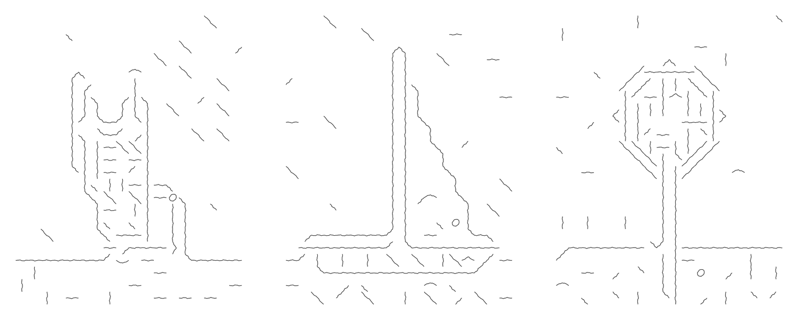
- Changed (Step 8): black-line render of the run-full-v6 scenes (`classes-ink-v7.json`); the tree octagon edges now read as clean diagonals, while the sail hypotenuse stays a staircase. Piece shared: AB 0 (0.00%), AC 0, BC 0. Piece gates: PASS. Scene gates: FAIL, identical to run-full-v6. No evaluation of this run.

### run-full-v5eq2
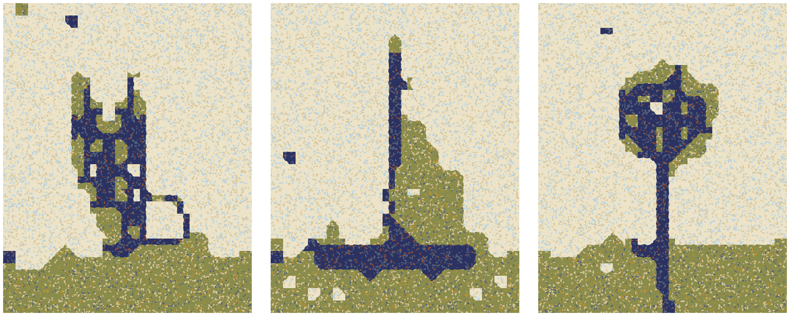
- Changed (Step 7b, equalizer v2, `docs/FINDINGS.md` entry 21): surplus 41 / 33 / 44 falls to 10 / 7 / 10. Piece shared: AB 0, AC 0, BC 0. Piece gates: PASS. Scene gates: FAIL, same-position excl. L 38-51%, 2x2 reuse 71-74%.
- Evaluation (`blind-test-3`): distinctiveness 4/5 (A vs B 3/5). Tree 4/5. Cat and sailboat not named; B read as a lighthouse or obelisk (2/5). Stray blocks 2-5 per image, down from 25-40 in v5. Grid 4 / 4 / 3.

### run-ink-v5eq2
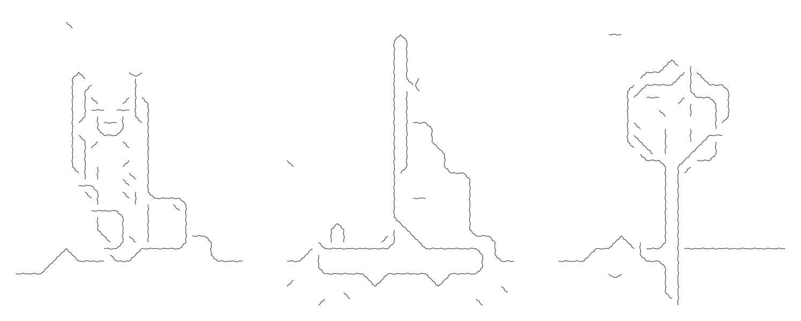
- Black-line render of the run-full-v5eq2 scenes (`classes-ink.json`). Piece gates PASS, scene gates FAIL, identical to run-full-v5eq2. No evaluation of this run.

## 006: Direction B (Garden Terrazzo)

**Goal:** no README.md in this folder. `NOTES.md` describes the Direction B class spec: 14 non-directional classes with four rotations, built from `docs/design/alt-b/02-piece-classes.md`.

**Blind test:** none in this folder.

### run-none

- Piece shared: AB 7 (4.93%), AC 2 (1.41%), BC 4 (2.82%). Largest cluster 2.
- Piece gates: PASS. Scene gates: PASS.

### run-quarter

- Piece shared: AB 1 (0.70%), AC 0, BC 0.
- Piece gates: PASS. Scene gates: PASS.

## 008: Mixed frames

**Goal:** can three images with different aspect ratios share one 480-piece set? A is a tree at 20x24 (portrait), B a sailboat at 30x16 (landscape), C a panorama at 40x12.

**Validity:** round 1 gives no valid solution. `run-quarter` has 3 mating violations (one per map) after 300k iterations. `run-flat` adds 64 extra flat pieces and has 41 violations. Round 1 piece and scene numbers are indicative only. Round 2 (below) is valid. **Blind test and grid visibility:** not evaluated for either round.

### run-quarter

- Piece shared: AB 0, AC 0, BC 0. Same-position overlap is n/a (shapes differ).
- Piece gates: PASS (invalid run). Scene gates: FAIL. 2x2 window reuse plain/rotated A-B 0.61/0.84, A-C 0.72/0.83, B-C 0.74/0.81 (limit 30%).

### run-flat

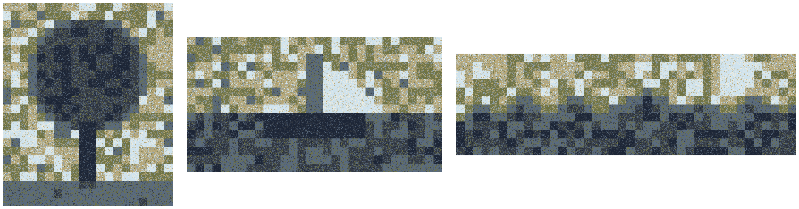

- Piece shared: AB 0, AC 0, BC 0. Rotation none.
- Piece gates: PASS (invalid run). Scene gates: FAIL, with the same 2x2 reuse failures as run-quarter.

### run-quarter-v2 (round 2)

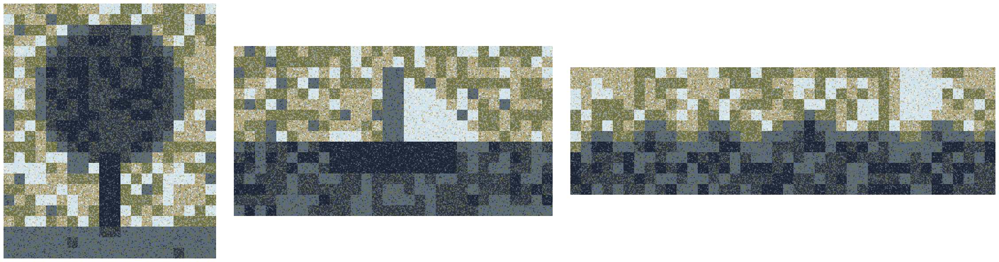

- Changed: round 2, now valid; feasibility demonstration of mixed frames and interior seams. Seams A / B / C: 23 / 21 / 15.
- Piece shared: AB 0, AC 0, BC 0. Piece gates: PASS. Scene gates: FAIL, 2x2 window reuse 60.6 / 71.6 / 73.6% (limit 30%).

### run-flat-v2 (round 2)

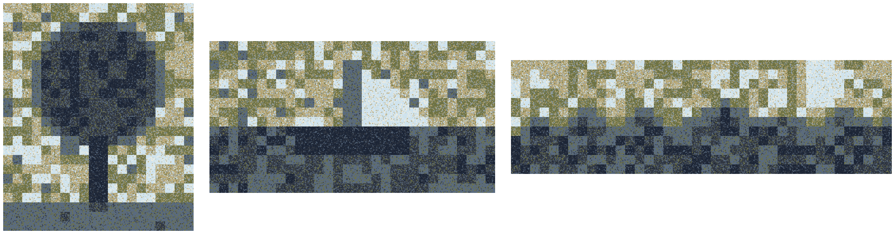

- Changed: round 2, now valid; feasibility demonstration of mixed frames and interior seams. Seams A / B / C: 82 / 80 / 74.
- Piece shared: AB 2 (0.22%), AC 0, BC 0. Piece gates: PASS. Scene gates: FAIL, 2x2 window reuse 60.6 / 71.6 / 73.6% (limit 30%).

## 011: Subjects, "Field, Wood and Water"

**Goal:** a hare at dawn (A), an owl at dusk (B) and a swan at midnight (C) on a tray border with quarter rotation, in value inversion: D = field / owl / night sky, M = hare / dusk sky / lake, L = sky / moon and snow / swan, with S chips and W cloud or swell tiers. Design in `experiments/011-subjects/README.md`. The earlier hare, owl and whale attempt is kept in `prev-attempt/` (20x25, 2x2 reuse 64.7 / 64.9 / 66.2%, scene gates FAIL):

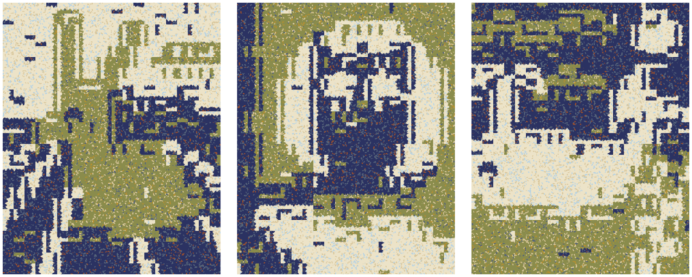

**Latest blind tests** (first 27x38 run, `blind-test-full-1.md` and `blind-test-ink-1.md`). Colour: distinctiveness 4/5, grid 3 / 3 / 3; the owl is recognized (4/5), the hare reads as a creature (2/5) and the swan is partly read (2/5). Ink: distinctiveness 5/5; hare ears 4/5, owl face 4/5, swan 2/5. No blind test covers 27x38-v2 yet.

Scene gates below are 2x2 window reuse for A-B / A-C / B-C (limit 30%). Left triptych full, right ink.

**27x38 v1, resampled 20x25 sketches.** Shared 0/0/0 in both, piece gates PASS, scene gates FAIL (80.8 / 81.1 / 82.0%). 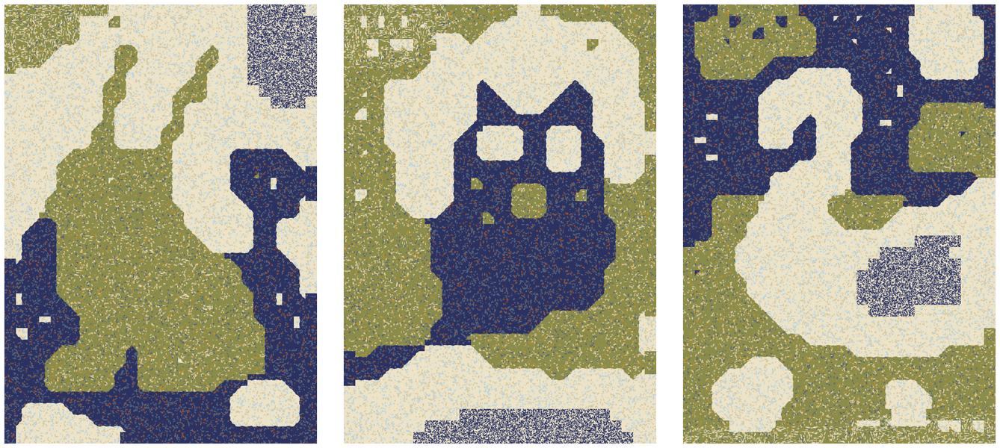 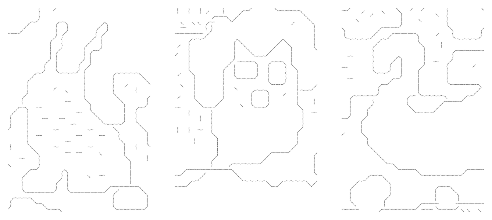

**27x38 v2, S-L transitions.** The pipeline adds transitions between the S chips and L. Shared 0/0/0 in both, piece gates PASS, scene gates FAIL (79.9 / 77.9 / 78.9%).  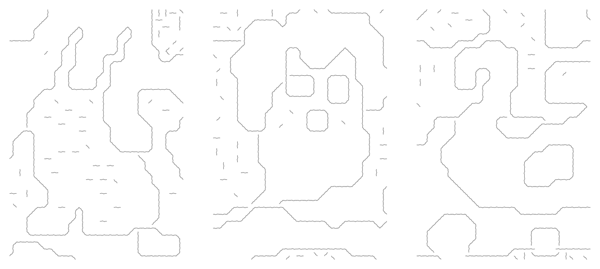

**27x38 v3, surplus placement policy.** The pipeline adds the surplus placement policy. Shared 0/0/0 in both, piece gates PASS, scene gates FAIL (79.7 / 78.2 / 79.7%). 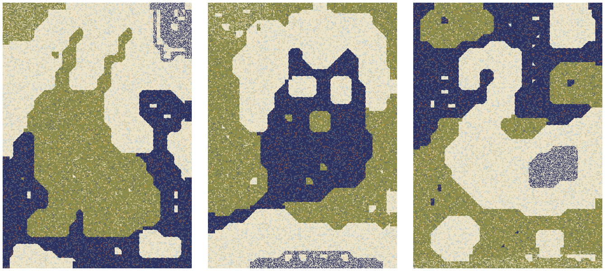 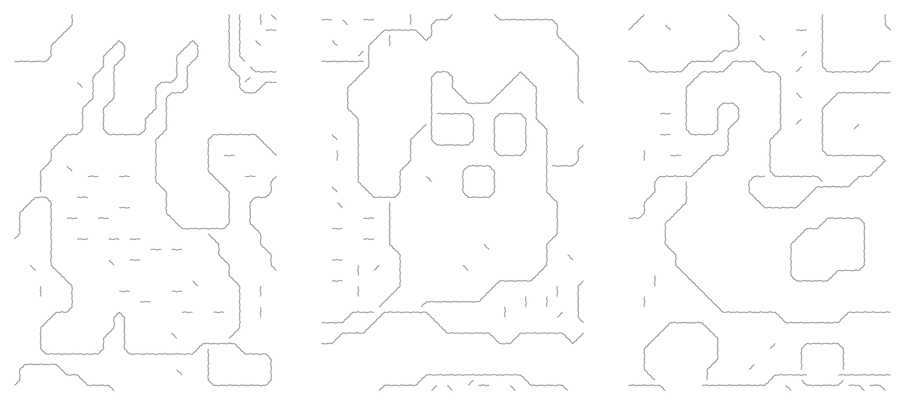

**27x38-v2, all three animals redrawn natively.** The hare, owl and swan are drawn at 27x38 rather than resampled, with the W and S budgets matched. Shared 0/0/1 (one BC pair, cluster 2), piece gates PASS, scene gates FAIL (71.3 / 64.3 / 68.3%; transferable blob 10.3% and 11.5% of A for A-B and A-C). **Current best full render** (`run-full`) and **current best ink render** (`run-ink`). 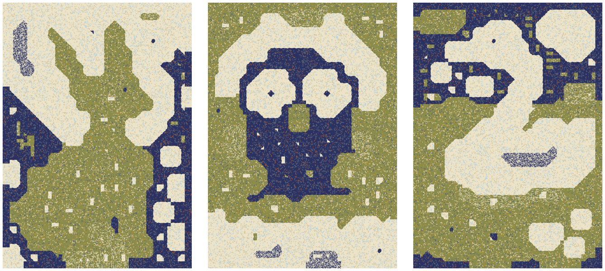 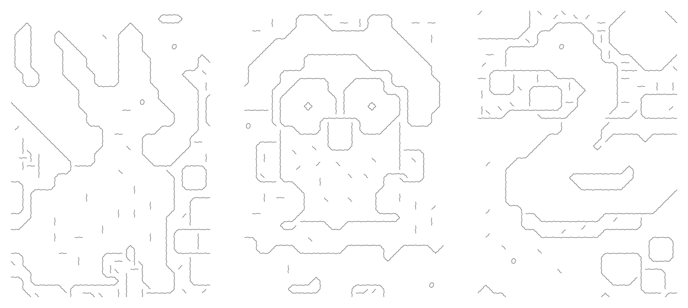

## 013: Scale study, 500 to 1536 pieces

Seed 0, one run per size, the same placeholder scenes (cat, sailboat, tree), no blind test. Figures come from `experiments/013-scale/README.md` and each run's `summary.md`. Every run has piece shared 0 / 0 / 0 and piece gates PASS; scene gates FAIL at every size. Left triptych full, right ink.

**20x25 (500 pieces).** Mean surplus 43%, 2x2 reuse A-C 76.5%. Visual read: cat recognisable, sail steps visible at 32 px. 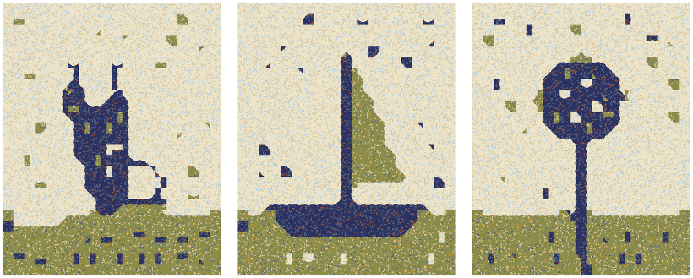 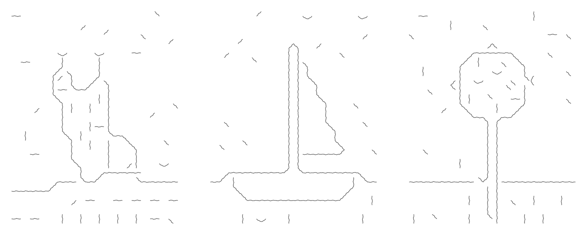

**25x30 (750 pieces).** Mean surplus 43%, 2x2 reuse A-C 86.5%. Visual read: cat recognisable, tail reads as a boxy loop. 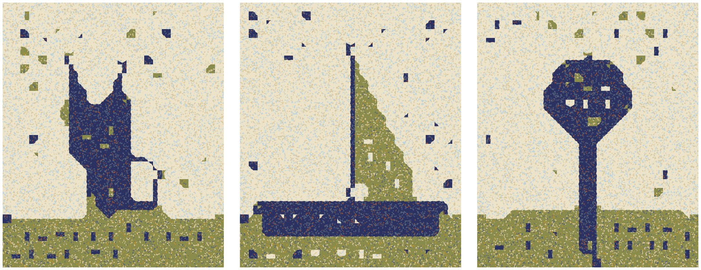 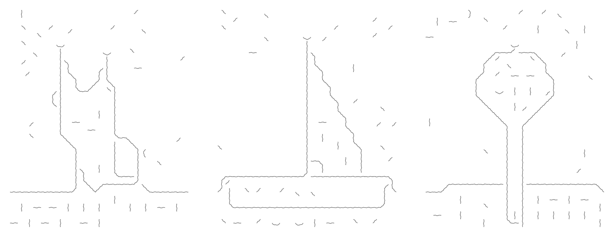

**27x38 (1026 pieces), working grid.** Placeholder scenes; the working grid adopted in `docs/DECISIONS.md`. The best full render is now 011 `27x38-v2/run-full`. Mean surplus 36%, the lowest of the four; 2x2 reuse A-C 90.2%; pipeline 162 s. Visual read: cat recognisable with ears and tail, sail steps finer. 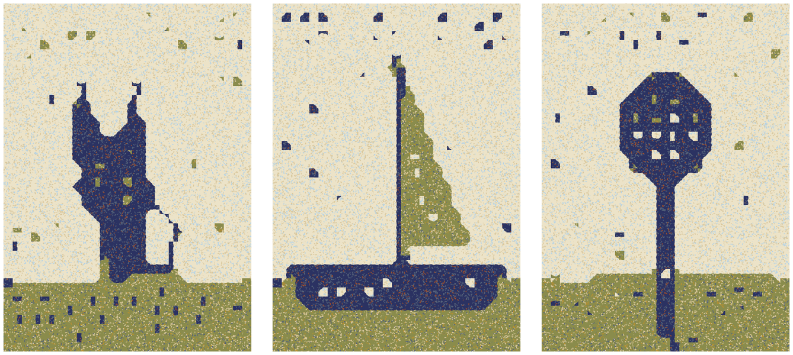 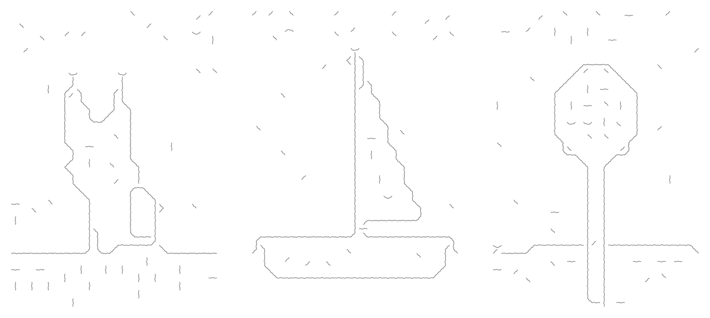

**32x48 (1536 pieces).** Mean surplus 45%, 2x2 reuse A-C 88.3%; pipeline 256 s. Visual read: cat broken, tail a thin line; surplus does not shrink relative to the figure. 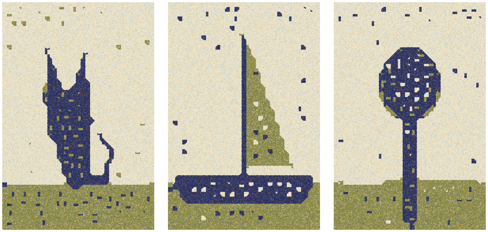 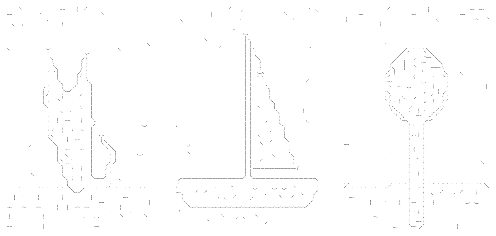
