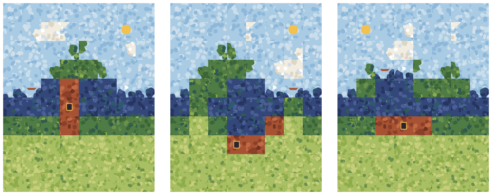
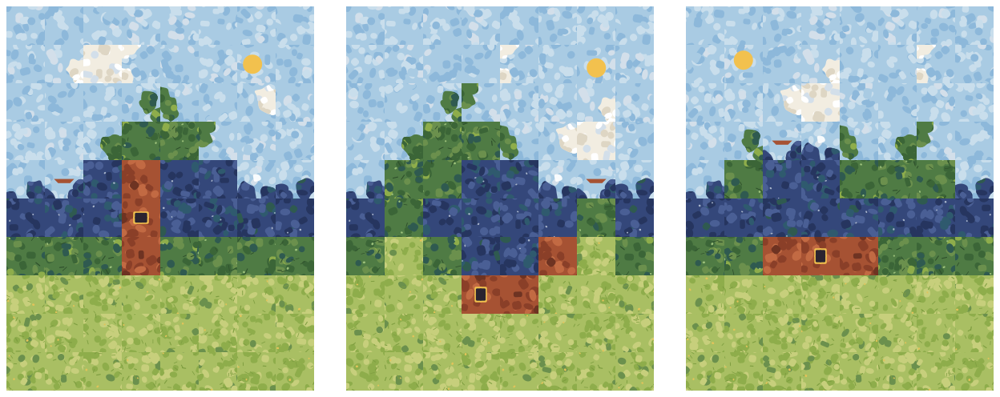
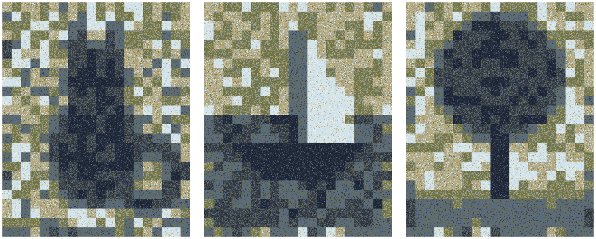
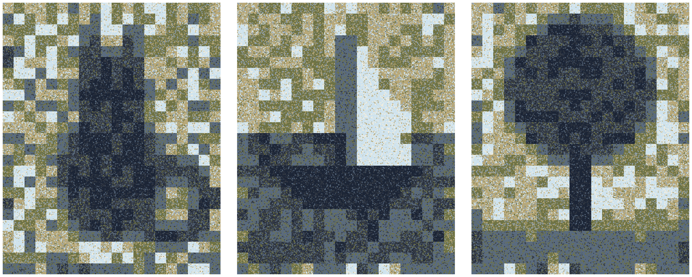
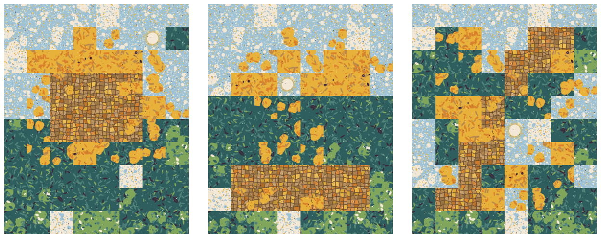
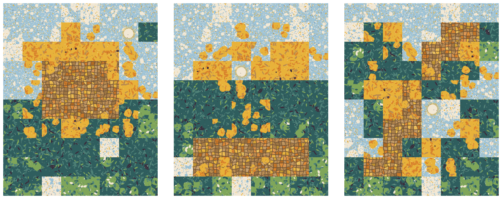

# Prototype gallery

Visual index of the `experiments/` runs that produced a `triptych.png`. Figures come from each run's `summary.md` and the experiment README. Distinctiveness and grid scores come from the latest `blind-test-*.md` in the folder. A dash means not recorded. Folders 001, 003, 005 and 007 have no triptych and are not listed. 003, 005 and 007 also have no README.

## At a glance

| Experiment | Run | Size (cols x rows) | Rotation | Shared AB / AC / BC | Piece gates | Scene gates | Distinctiveness | Grid score (A / B / C) |
|---|---|---|---|---|---|---|---|---|
| 002 | run-none | 8x10 | none | 13 / 11 / 15 | FAIL\* | FAIL\* | - | - |
| 002 | run-none-v2 | 8x10 | none | 10 / 13 / 14 | FAIL | FAIL | - | - |
| 002 | run-quarter | 8x10 | quarter | 4 / 5 / 4 | PASS | FAIL | 2/5 | 3 / 4 / 3 |
| 004 | run-none | 20x25 | none | 0 / 1 / 0 | PASS | FAIL | - | - |
| 004 | run-quarter | 20x25 | quarter | 0 / 0 / 0 | PASS | FAIL | 4/5 | 5 / 5 / 5 |
| 006 | run-none | 8x10 | none | 7 / 2 / 4 | PASS | PASS | - | - |
| 006 | run-quarter | 8x10 | quarter | 1 / 0 / 0 | PASS | PASS | - | - |

- Shared counts are piece-level adjacencies: pieces touching in both solutions of the pair.
- Blind tests cover one run each: 002 `blind-test-2` and 004 `blind-test-1`, both on run-quarter.
- \* 002 run-none's `summary.md` has no Gates section. Its gate values come from the round 2 table in `experiments/002-direction-a/README.md`.

## 002: Direction A, first end-to-end render

**Goal:** first end-to-end render of design direction A ("Dapple Mosaic") with three 8x10 scenes: The Lone Tree (A), Isle and Sail (B), Snow Peak (C).

**Latest blind test** (`blind-test-2.md`, run-quarter): distinctiveness 2/5, grid A 3, B 4, C 3. The tree is named at 2/5 and B and C are unnamed. The earlier test on run-none scored distinctiveness 3/5 and grid 1 / 4 / 3. The README retires this scene set.

**Scene gates, all 002 runs:** FAIL. Same-position overlap 66-71%, 2x2 window reuse 44-57%, transferable blob 27.5-30%. Limits are 25%, 30% and 10%.

### run-none (v1)

- Piece shared: AB 13 (9.15%), AC 11 (7.75%), BC 15 (10.56%). Largest cluster 6.
- Piece gates: FAIL\*. Scene gates: FAIL\*.

### run-none-v2

- Piece shared: AB 10 (7.04%), AC 13 (9.15%), BC 14 (9.86%). Largest cluster 6 (AC and BC).
- Piece gates: FAIL (AB, AC and BC each above the 5% limit; AC and BC clusters of 6 against a limit of 4). Scene gates: FAIL.

### run-quarter

- Piece shared: AB 4 (2.82%), AC 5 (3.52%), BC 4 (2.82%). Largest cluster 3.
- Piece gates: PASS. Scene gates: FAIL.

## 004: Density-field mosaic

**Goal:** each piece is a mixture of stipple dapples, and six tone classes (T0 dark to T5 light) render three 20x25 tone maps (cat, sailboat, tree) that share one exact class histogram.

**Latest blind test** (`blind-test-1.md`, run-quarter): distinctiveness 4/5, grid 5/5 on A, B and C. The tree is recognised (canopy and trunk 4/5). The cat is not recognised and the sailboat is only partly read.

### run-none

- Piece shared: AB 0, AC 1 (0.10%), BC 0.
- Piece gates: PASS. Scene gates: FAIL. A-B 2x2 reuse 44.1% (limit 30%), A-C same-position 25.0% (limit 25%), A-C 2x2 reuse 57.2% (limit 30%), B-C 2x2 reuse 79.6% (limit 30%).

### run-quarter

- Piece shared: AB 0, AC 0, BC 0.
- Piece gates: PASS. Scene gates: FAIL, with the same failures as run-none.

## 006: Direction B (Garden Terrazzo)

**Goal:** no README.md in this folder. `NOTES.md` describes the Direction B class spec: 14 non-directional classes with four rotations, built from `docs/design/alt-b/02-piece-classes.md`.

**Blind test:** none in this folder.

### run-none

- Piece shared: AB 7 (4.93%), AC 2 (1.41%), BC 4 (2.82%). Largest cluster 2.
- Piece gates: PASS. Scene gates: PASS.

### run-quarter

- Piece shared: AB 1 (0.70%), AC 0, BC 0.
- Piece gates: PASS. Scene gates: PASS.
